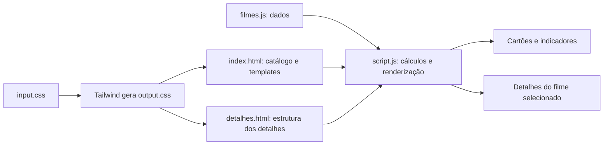

# Guia de estudo e apresentação — CineAtlas

Este guia explica como o catálogo de filmes foi organizado, como os dados viram conteúdo na página e quais tecnologias aparecem nos arquivos. Ele também pode servir como roteiro para apresentar o projeto.

## 1. Visão geral

O CineAtlas é um site estático de catálogo de filmes. A página inicial mostra os filmes, avaliações e uma recomendação. Cada cartão abre uma página com sinopse, elenco e resenhas.

O projeto foi dividido em três partes principais:

- **HTML** define a estrutura e os espaços onde o conteúdo aparece.
- **JavaScript** lê os dados, calcula os indicadores e preenche o HTML.
- **Tailwind CSS** fornece as classes visuais; o arquivo de entrada também define o fundo do site.

Os dados ficam em `src/filmes.js`. Não há servidor de aplicação, banco de dados ou consulta dinâmica a uma API: o conteúdo é mantido diretamente no projeto.



## 2. Estrutura dos arquivos

| Arquivo | Responsabilidade |
| --- | --- |
| `src/index.html` | Página principal: apresentação, indicadores, lista, critérios e recomendação. |
| `src/detalhes.html` | Estrutura da página de detalhes e seus templates de elenco e resenhas. |
| `src/script.js` | Cálculos, seleção de dados, montagem de cartões e preenchimento das páginas. |
| `src/filmes.js` | Lista local de filmes, com notas, imagens, elenco e resenhas. |
| `src/input.css` | Entrada do Tailwind e regras CSS do tema escuro em tons quentes. |
| `src/output.css` | CSS gerado pelo Tailwind a partir das classes encontradas no projeto. |
| `package.json` | Dependências e comandos de desenvolvimento e compilação do CSS. |
| `dockerfile` e `compose.yaml` | Definição dos contêineres para gerar o CSS e servir os arquivos pelo Nginx. |

As imagens usadas pelo site estão em `src/Imagens Ultilizados/` (o nome da pasta foi mantido como está no projeto). A marca usa `atlas-cineatlas.jpeg` e o banner da abertura usa `banner-xiao-tong.jpeg`. O `README.md` identifica o projeto como uma apresentação estudantil e registra os contribuidores.

## 3. Como os dados de filmes são organizados

Em `src/filmes.js`, o `export default` disponibiliza uma lista de objetos para ser importada por outro módulo. Cada objeto representa um filme. A lista atual contém seis filmes.

Um registro tem, entre outros, os campos:

```js
{
  id: 1,
  title: "Expresso da Meia-Noite",
  year: 1978,
  director: "Alan Parker",
  rating: 8.0,
  criticScore: 90,
  audienceScore: 88,
  reviews: [/* resenhas */],
  cast: [/* elenco */]
}
```

- `id` é o identificador usado no endereço da página de detalhes.
- `title`, `year`, `director`, `genre`, `runtime` e `synopsis` descrevem o filme.
- `rating` é a nota de 0 a 10 usada pelo catálogo e para escolher o destaque.
- `criticScore` e `audienceScore` são percentuais de aprovação usados no cálculo da média.
- `criticReviews`, `audienceRatings` e `audienceRatingCount` alimentam a apresentação das quantidades. `audienceRatings` é o texto mostrado na página de detalhes; `audienceRatingCount` é o número usado na soma do catálogo.
- `image` guarda o caminho da imagem local. `imageSource` registra uma fonte associada à imagem nos dados.
- `ratingsSource` é o endereço exibido como fonte das notas.
- `reviews` é uma lista de objetos com `title` e `text`.
- `cast` é uma lista de objetos com nome do ator (`name`) e personagem (`character`).
- `recommendationOverride` é opcional e permite ajustar editorialmente o rótulo de classificação de um filme. O primeiro registro usa esse ajuste.

As listas internas `reviews` e `cast` permitem repetir a mesma lógica de renderização para qualquer filme, sem escrever um bloco HTML diferente para cada ator ou resenha.

## 4. Página inicial — `src/index.html`

### Cabeçalho e metadados

O documento começa declarando HTML5 e o idioma `pt-BR`. No `<head>`, a codificação UTF-8 permite exibir acentos, a configuração `viewport` adapta a página a telas menores e a descrição ajuda a identificar o conteúdo. O arquivo carrega `output.css` e inicia `script.js` como módulo:

```html
<link rel="stylesheet" href="output.css" />
<script type="module" src="./script.js"></script>
```

O uso de `type="module"` permite que o JavaScript importe a lista de filmes com `import`.

### Navegação e seções

O `<header>` contém a marca e links que levam às seções por meio de âncoras, como `href="#filmes"`. O `<main>` agrupa o conteúdo principal. Cada seção tem um propósito:

1. **Abertura / hero:** imagem `banner-xiao-tong.jpeg` ao fundo, título, texto introdutório e botão para ir ao catálogo. A classe `hero-dark` ajusta o contraste dos textos sobre a imagem.
2. **Indicadores:** quantidade de filmes, média geral e classificação. Os elementos têm IDs (`total-filmes`, `media-geral`, `classificacao-geral`) para que o JavaScript encontre e atualize seus textos.
3. **Filmes avaliados:** contém o espaço vazio `#lista-filmes`, preenchido em tempo de execução.
4. **Critérios:** explica os quatro aspectos editoriais apresentados: história, atuações, técnica e impacto.
5. **Recomendação:** o espaço `#recomendacao` recebe o filme com a maior nota de catálogo.
6. **Rodapé:** informações finais e link para voltar ao topo.

O layout é escrito com classes utilitárias do Tailwind. Por exemplo, `grid`, `md:grid-cols-2` e `xl:grid-cols-3` mudam a quantidade de colunas conforme a largura da tela; classes como `px-6`, `text-slate-300` e `rounded-2xl` cuidam de espaçamento, cor e formato.

### Templates HTML

O elemento `<template id="template-filme">` descreve a aparência de um cartão, mas não é mostrado diretamente. Ele possui marcadores como `data-filme-titulo` e `data-filme-ano`. O JavaScript clona o template para cada registro e substitui os valores.

O `<template id="template-recomendacao">` segue o mesmo padrão para o destaque. Esse arranjo evita duplicar a estrutura HTML à mão e separa a apresentação dos dados.

Os atributos `aria-label`, `aria-live`, textos alternativos e títulos associados ajudam tecnologias assistivas a entenderem as regiões e atualizações. Ícones decorativos são marcados com `aria-hidden="true"` para não serem lidos como conteúdo.

## 5. Página de detalhes — `src/detalhes.html`

A página compartilha o cabeçalho, estilos e script com a página inicial. O conteúdo de detalhes começa oculto:

```html
<main id="detalhes-filme" hidden>
```

O JavaScript só o revela depois de encontrar um filme válido. Os espaços com IDs, como `#titulo-filme`, `#sinopse-filme`, `#nota-critica` e `#media-aprovacao`, são preenchidos com as informações desse registro.

As seções apresentam:

- resumo do filme, imagem, gênero, ano, duração e direção;
- nota do catálogo e gênero;
- aprovação da crítica e do público, média, total contabilizado e classificação;
- resenhas editoriais e elenco principal.

Os templates `#template-resenha` e `#template-ator` definem a estrutura repetida de cada item. Há também uma segunda área `<main id="filme-nao-encontrado" hidden>`: se o endereço tiver um ID que não corresponde a nenhum filme, essa mensagem é exibida no lugar dos detalhes.

### Como o link leva ao filme certo

Cada cartão aponta para `detalhes.html?id=...`, por exemplo `detalhes.html?id=2`. O valor após `?id=` é um parâmetro de consulta. A página de detalhes lê esse número e procura o registro cujo `id` seja igual.

## 6. Lógica JavaScript — `src/script.js`

### Importação e formatação

```js
import filmes from "./filmes.js";

const formatoNumero = new Intl.NumberFormat("pt-BR");
const formatoPercentual = new Intl.NumberFormat("pt-BR", {
  maximumFractionDigits: 1,
});
```

A importação traz a lista local. `Intl.NumberFormat` formata números conforme a convenção brasileira. O percentual pode ter até uma casa decimal.

`estilosClassificacao` associa os rótulos “Muito recomendado”, “Recomendado” e “Mediano” às classes visuais correspondentes. Assim, a regra e as cores são escolhidas juntas.

### Cálculo da média

```js
function calcularMedia(notas) {
  let soma = 0;
  for (const nota of notas) soma += nota;
  if (notas.length === 0) return 0;
  return soma / notas.length;
}
```

A função soma os valores e divide pela quantidade. Se a lista estiver vazia, devolve zero para evitar divisão por zero. Ela é reutilizada tanto para a média de um filme quanto para a média geral.

### Classificação

`classificarFilme(mediaAprovacao, ajusteEditorial)` verifica primeiro se existe um ajuste editorial reconhecido. Se houver, usa esse rótulo. Caso contrário, aplica as faixas:

- 90% ou mais: **Muito recomendado**;
- de 75% até menos de 90%: **Recomendado**;
- abaixo de 75%: **Mediano**.

A função devolve um objeto com `nome` e `classes`. Quem chama a função usa o nome como texto e as classes para estilizar a etiqueta, com fundos claros para destacar as classificações sobre os painéis escuros.

### Indicadores por filme

`calcularIndicadores(filme)` filtra as notas de crítica e público para incluir apenas números válidos (`Number.isFinite`), calcula a média e soma a quantidade numérica de críticas e avaliações do público. A conversão `Number(...) || 0` faz um valor ausente ou inválido contribuir como zero.

A média usada no catálogo é **simples**: crítica e público têm o mesmo peso. A média geral também é simples: primeiro calcula a média de cada filme, depois calcula a média dessas médias. Não é uma média ponderada pelo número de avaliações.

`formatarAprovacao` acrescenta `%` ao valor formatado. `formatarQuantidadeAvaliacoes` apresenta a soma como “Mais de ... avaliações contabilizadas”.

### Criação de um cartão

`criarCard(filme)` executa esta sequência:

1. Localiza o template e cria uma cópia com `cloneNode(true)`.
2. Calcula indicadores e deixa a nota de catálogo com uma casa decimal (`toFixed(1)`).
3. Preenche os marcadores `data-*` com os dados do filme.
4. Adiciona as classes da classificação.
5. Define o caminho e o texto alternativo da imagem.
6. Monta o link com o ID do filme na query string.
7. Define um `aria-label` descritivo para a nota.
8. Devolve o cartão pronto para ser inserido na página.

O código usa `textContent` para inserir conteúdo textual. Isso faz o navegador tratar os valores como texto, em vez de interpretar strings do cadastro como marcação HTML.

### Renderização do catálogo

`renderizarCatalogo()` encontra os elementos da página inicial e verifica se a lista tem filmes.

Quando há dados, a função calcula as médias e a classificação geral, cria um `DocumentFragment` e percorre os filmes. Cada cartão é acrescentado ao fragmento. Durante o percurso, compara `rating` para encontrar o filme de maior nota e usá-lo na recomendação.

Ao terminar, `replaceChildren` atualiza a lista de uma vez. O método também é usado para inserir o conteúdo do destaque. Em seguida, são atualizados os três indicadores do topo. As mensagens `console.log` deixam os mesmos números disponíveis no console do navegador.

Se não houver filmes, a função apresenta uma mensagem na lista e define os indicadores para `00`, `—` e `Sem dados`.

### Renderização da página de detalhes

`renderizarDetalhes(filme)` recebe o objeto já encontrado e preenche o título do navegador, imagem, sinopse, dados básicos e notas. Depois clona os templates de ator e resenha em laços separados, preenche cada um e substitui o conteúdo das listas.

Ao final, remove o estado oculto de `#detalhes-filme`, tornando a página visível. A função retorna o ID do registro.

### Escolha entre catálogo e detalhes

No final do arquivo, o JavaScript verifica se existe `#lista-filmes` na página atual:

- se existir, entende que está em `index.html` e chama `renderizarCatalogo()`;
- se não existir, lê `id` com `URLSearchParams`, procura o filme usando `find` e chama `renderizarDetalhes()`;
- se `find` não encontrar um resultado, revela `#filme-nao-encontrado`.

Assim, o mesmo módulo atende às duas páginas sem precisar manter dois scripts separados.

## 7. Estilos e geração do CSS

Em `src/input.css`:

```css
@import "tailwindcss";
@source "./";
```

O import carrega o Tailwind CSS. A diretiva `@source` informa onde estão os arquivos com classes a analisar. O Tailwind então gera as regras necessárias em `src/output.css`.

O bloco `body` define três camadas de fundo: dois brilhos radiais em tons de ferrugem e marrom e um gradiente diagonal quase preto. `background-attachment: fixed` mantém o fundo preso à janela durante a rolagem. O tema visual atual usa tons quentes e escuros; regras adicionais em `input.css` adaptam cores utilitárias do Tailwind, como `slate` e `amber`, a essa paleta. A classe `hero-dark` reforça o contraste na abertura, e `warm-panel` aplica o fundo quente do painel de recomendação.

`output.css` é um arquivo gerado: o fluxo normal é editar `input.css` e as classes HTML, e então rodar o comando do Tailwind para atualizar a saída.

## 8. Dependências e execução

O `package.json` declara Tailwind CSS e sua CLI como dependências de desenvolvimento. Os comandos são:

```bash
npm install
npm run dev
```

`npm run dev` observa o CSS de entrada e gera `src/output.css` em modo de acompanhamento. Para uma compilação minificada, use `npm run build`.

O `dockerfile` parte de `node:22-alpine`, define `/app` como diretório de trabalho, instala as dependências a partir dos arquivos de pacote e copia o projeto. O comando padrão do contêiner inicia o modo de desenvolvimento.

O `compose.yaml` define dois serviços:

- **`tailwind`** constrói o ambiente Node, monta o projeto para que as alterações apareçam e executa o comando de acompanhamento do CSS.
- **`web`** usa Nginx para servir o conteúdo da pasta `src` na porta `8080` do computador. O volume é somente leitura para o Nginx.

Com Docker Compose instalado, a inicialização configurada é:

```bash
docker compose up --build
```

Depois, abra `http://localhost:8080`. O serviço do Tailwind gera o CSS e o Nginx entrega as páginas e os arquivos estáticos.

## 9. Como o projeto foi construído

O desenho da aplicação segue uma separação simples de responsabilidades:

1. **Definir os dados:** cada filme é cadastrado como um objeto e todos ficam em uma lista exportada.
2. **Desenhar a estrutura:** as páginas HTML reservam os espaços e declaram templates para itens repetidos.
3. **Conectar dados e interface:** o script importa a lista, calcula as notas e preenche os espaços do DOM.
4. **Estilizar:** classes utilitárias definem layout e aparência; o CSS próprio complementa o fundo.
5. **Servir os arquivos:** Nginx entrega os arquivos estáticos e o contêiner Node recompila o CSS durante o desenvolvimento.

Para cadastrar outro filme, a alteração principal é adicionar um objeto com os mesmos campos em `src/filmes.js`. A listagem e os detalhes reutilizam o mesmo código e os mesmos templates.

## 10. Roteiro curto para apresentar

> “Este é o CineAtlas, um catálogo estático de filmes avaliados. Os dados estão separados da interface em um arquivo JavaScript. A página inicial usa templates HTML que o script clona para gerar os cartões. Para cada filme, calculamos a média simples entre as aprovações da crítica e do público e aplicamos faixas para exibir uma classificação. Cada cartão leva à página de detalhes passando o ID do filme pela URL. Na página de detalhes, o mesmo script procura esse ID e preenche sinopse, avaliações, resenhas e elenco. O visual é responsivo com Tailwind CSS, e o Docker Compose reúne um serviço que gera o CSS e outro que serve o site pelo Nginx.”

### Conceitos que podem ser perguntados

- **Por que separar `filmes.js` de `script.js`?** Para manter cadastro de conteúdo separado das regras que o exibem.
- **O que é um template?** Uma estrutura HTML reutilizável que o JavaScript clona e preenche.
- **Como a navegação encontra o filme?** O link passa `id` na query string e `URLSearchParams` lê esse parâmetro.
- **Como a média é calculada?** A média entre aprovação da crítica e aprovação do público; a média geral considera igualmente a média de cada filme.
- **Há back-end?** Não. Os dados são locais e as páginas são servidas como arquivos estáticos.
- **O que o Tailwind faz aqui?** Converte classes utilitárias usadas no HTML em regras CSS no arquivo de saída.

## 11. Observação sobre os números

O próprio texto das páginas informa que as classificações seguem as faixas descritas neste guia. Também informa que os totais de público são estimativas editoriais distribuídas por faixa de nota e não contagens oficiais da fonte. Ao apresentar o trabalho, vale explicar que os dados estão cadastrados no projeto e que as médias são cálculos editoriais simples.
